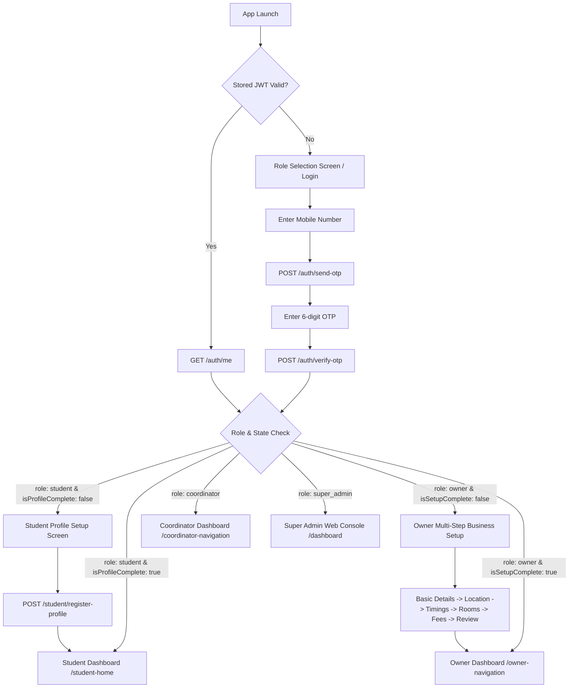
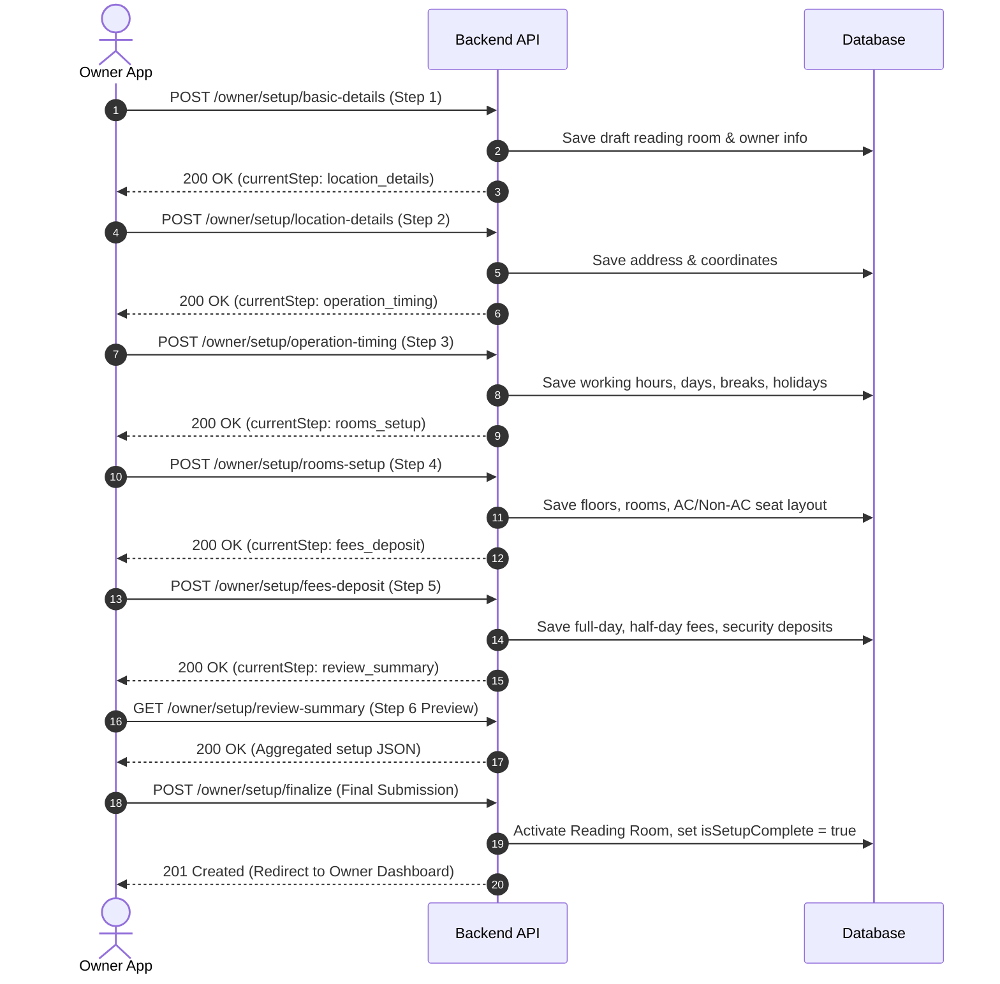

# SmartLibrary — Full Authentication & Registration API Specification

This document details the complete end-to-end authentication and registration lifecycle for the **SmartLibrary** platform across all user roles (**Owner**, **Coordinator**, **Student**, and **Super Admin**). It covers initial OTP verification, token lifecycle, multi-step business onboarding for owners, student profile registration, coordinator provisioning, error contracts, and client-side route transitions.

---

## 1. Architecture Overview

### 1.1 Base Configuration
- **Base URL**: `https://api.smartlibrary.app/v1`
- **Security Standard**: JSON Web Tokens (JWT)
  - **Access Token**: Short-lived (15 days), passed via HTTP `Authorization` header.
  - **Refresh Token**: Long-lived (30 days rolling), stored securely in client storage (`flutter_secure_storage` / encrypted SharedPreferences).
- **Standard Request Header**:
  ```http
  Authorization: Bearer <JWT_ACCESS_TOKEN>
  Content-Type: application/json
  Accept: application/json
  ```

### 1.2 Unified API Response Envelope
All API endpoints follow a strict uniform JSON envelope:

#### Success Response Format
```json
{
  "success": true,
  "statusCode": 200,
  "message": "Operation completed successfully",
  "data": {},
  "timestamp": "2026-11-24T10:00:00Z"
}
```

#### Error Response Format
```json
{
  "success": false,
  "statusCode": 400,
  "error": "INVALID_OTP",
  "message": "The 6-digit verification code entered is invalid or has expired.",
  "errors": [
    {
      "field": "otp",
      "message": "Must be exactly 6 numeric digits."
    }
  ],
  "timestamp": "2026-11-24T10:00:00Z"
}
```

### 1.3 Role Resolution & Client Navigation State Machine



---

## 2. Shared Authentication Endpoints

These endpoints power the primary phone-based authentication used by **Owner**, **Coordinator**, and **Student**.

### 2.1 Send Mobile OTP
- **Endpoint**: `POST /auth/send-otp`
- **Authentication**: None (Public)
- **Description**: Triggers a 6-digit SMS OTP via SMS Gateway (e.g., MSG91 / Twilio) to the specified Indian mobile number.
- **Request Body**:
  ```json
  {
    "phone": "9876543210",
    "countryCode": "+91",
    "role": "owner"
  }
  ```
  *Fields:*
  - `phone` (string, required): 10-digit mobile number matching `^[6-9]\d{9}$`.
  - `countryCode` (string, optional): Default `+91`.
  - `role` (string, required): Enum `owner` | `coordinator` | `student`.
- **Response (`200 OK`)**:
  ```json
  {
    "success": true,
    "statusCode": 200,
    "message": "OTP sent successfully to +91 9876543210",
    "data": {
      "sessionId": "sess_otp_982341aef",
      "expiresInSeconds": 300,
      "resendAvailableInSeconds": 30
    },
    "timestamp": "2026-11-24T10:00:00Z"
  }
  ```

---

### 2.2 Resend OTP
- **Endpoint**: `POST /auth/resend-otp`
- **Authentication**: None (Public)
- **Description**: Resends OTP if the 30-second client cooldown has passed.
- **Request Body**:
  ```json
  {
    "sessionId": "sess_otp_982341aef",
    "phone": "9876543210"
  }
  ```
- **Response (`200 OK`)**:
  ```json
  {
    "success": true,
    "statusCode": 200,
    "message": "A new verification code has been dispatched.",
    "data": {
      "sessionId": "sess_otp_982341aef",
      "expiresInSeconds": 300,
      "resendAvailableInSeconds": 30
    },
    "timestamp": "2026-11-24T10:00:35Z"
  }
  ```

---

### 2.3 Verify OTP & Establish Session
- **Endpoint**: `POST /auth/verify-otp`
- **Authentication**: None (Public)
- **Description**: Verifies the 6-digit code. If valid, issues JWT access and refresh tokens, returns current account profile and onboarding state flags.
- **Request Body**:
  ```json
  {
    "sessionId": "sess_otp_982341aef",
    "phone": "9876543210",
    "otp": "452189",
    "role": "owner"
  }
  ```
- **Response (`200 OK`) — Owner Returning / Incomplete Setup**:
  ```json
  {
    "success": true,
    "statusCode": 200,
    "message": "Phone number verified successfully.",
    "data": {
      "accessToken": "eyJhbGciOiJIUzI1NiIsInR5cCI6IkpXVCJ9...",
      "refreshToken": "ref_8f92a104bcde...",
      "expiresInSeconds": 1296000,
      "user": {
        "id": "usr_own_9021",
        "phone": "+919876543210",
        "role": "owner",
        "name": "Arjun Sanise",
        "email": "arjun.sanise@gmail.com",
        "isSetupComplete": false,
        "currentSetupStep": "basic_details",
        "readingRoomId": "hub_draft_401",
        "createdAt": "2026-11-24T10:00:00Z"
      }
    },
    "timestamp": "2026-11-24T10:01:00Z"
  }
  ```
- **Response (`200 OK`) — New Student (Profile Incomplete)**:
  ```json
  {
    "success": true,
    "statusCode": 200,
    "message": "OTP verified successfully.",
    "data": {
      "accessToken": "eyJhbGciOiJIUzI1NiIsInR5cCI6IkpXVCJ9...",
      "refreshToken": "ref_118a90df1bce...",
      "expiresInSeconds": 1296000,
      "user": {
        "id": "usr_std_501",
        "phone": "+919876543210",
        "role": "student",
        "name": null,
        "email": null,
        "isProfileComplete": false,
        "createdAt": "2026-11-24T10:01:00Z"
      }
    },
    "timestamp": "2026-11-24T10:01:00Z"
  }
  ```

---

### 2.4 Google OAuth Sign-In (Planned / One-Tap)
- **Endpoint**: `POST /auth/google`
- **Authentication**: None (Public)
- **Description**: Exchanges Google OAuth ID token for a SmartLibrary session.
- **Request Body**:
  ```json
  {
    "idToken": "eyJhbGciOiJSUzI1NiIsImtpZCI6Ij...",
    "role": "student"
  }
  ```
- **Response (`200 OK`)**: Same schema as `/auth/verify-otp`.

---

### 2.5 Refresh Access Token
- **Endpoint**: `POST /auth/refresh-token`
- **Authentication**: None
- **Description**: Swaps an unexpired refresh token for a fresh access token without interrupting user interaction.
- **Request Body**:
  ```json
  {
    "refreshToken": "ref_8f92a104bcde..."
  }
  ```
- **Response (`200 OK`)**:
  ```json
  {
    "success": true,
    "statusCode": 200,
    "message": "Access token refreshed.",
    "data": {
      "accessToken": "eyJhbGciOiJIUzI1NiIsInR5cCI6IkpXVCJ9...",
      "refreshToken": "ref_90ab34cde781...",
      "expiresInSeconds": 1296000
    },
    "timestamp": "2026-11-24T10:05:00Z"
  }
  ```

---

### 2.6 Get Current User Session (`/auth/me`)
- **Endpoint**: `GET /auth/me`
- **Authentication**: Bearer Token
- **Description**: Returns profile, role, permissions, and active hub IDs for session recovery on application cold start.
- **Response (`200 OK`)**:
  ```json
  {
    "success": true,
    "statusCode": 200,
    "data": {
      "id": "usr_own_9021",
      "phone": "+919876543210",
      "role": "owner",
      "name": "Arjun Sanise",
      "email": "arjun.sanise@gmail.com",
      "isSetupComplete": true,
      "readingRooms": [
        {
          "id": "hub_01",
          "name": "Focus Study Point",
          "branch": "Sadashiv Peth",
          "city": "Pune",
          "totalSeats": 140,
          "occupiedSeats": 112
        }
      ]
    },
    "timestamp": "2026-11-24T10:05:00Z"
  }
  ```

---

### 2.7 Logout
- **Endpoint**: `POST /auth/logout`
- **Authentication**: Bearer Token
- **Description**: Revokes the active access and refresh token.
- **Request Body**:
  ```json
  {
    "refreshToken": "ref_8f92a104bcde..."
  }
  ```
- **Response (`200 OK`)**:
  ```json
  {
    "success": true,
    "statusCode": 200,
    "message": "Session terminated successfully."
  }
  ```

---

## 3. Owner Registration Flow (Multi-Step Business Onboarding)

When an Owner registers or logs in with `isSetupComplete: false`, the app guides them through 6 structured setup screens. The backend persists state progressively so the owner can exit and resume anytime.



---

### Step 1: Basic Reading Room Details
- **Endpoint**: `POST /owner/setup/basic-details`
- **Authentication**: Bearer Token (Owner)
- **App Route**: `AppRoutes.basicDetails`
- **Description**: Registers the fundamental business entity details.
- **Request Body**:
  ```json
  {
    "readingRoomName": "Focus Study Point",
    "branchName": "Main Branch",
    "ownerName": "Arjun Sanise",
    "phone": "+919876543210",
    "email": "arjun.sanise@gmail.com"
  }
  ```
  *Validation Rules:*
  - `readingRoomName`: String, 3–100 chars (Required).
  - `branchName`: String, optional.
  - `ownerName`: String, 2–80 chars (Required).
  - `phone`: String, 10-digit phone prefilled from session (Required).
  - `email`: Valid email format (Required).
- **Response (`200 OK`)**:
  ```json
  {
    "success": true,
    "statusCode": 200,
    "message": "Basic details recorded.",
    "data": {
      "readingRoomId": "hub_draft_401",
      "nextStep": "location_details",
      "basicDetails": {
        "readingRoomName": "Focus Study Point",
        "branchName": "Main Branch",
        "ownerName": "Arjun Sanise",
        "email": "arjun.sanise@gmail.com"
      }
    }
  }
  ```

---

### Step 2: Location & Address Details
- **Endpoint**: `POST /owner/setup/location-details`
- **Authentication**: Bearer Token (Owner)
- **App Route**: `AppRoutes.locationDetails`
- **Description**: Sets the physical premises address of the reading room hub.
- **Request Body**:
  ```json
  {
    "readingRoomId": "hub_draft_401",
    "address": "2nd Floor, Unit 201, Above SBI Bank",
    "area": "Sadashiv Peth",
    "city": "Pune",
    "state": "Maharashtra",
    "pincode": "411030",
    "latitude": 18.5123,
    "longitude": 73.8567
  }
  ```
  *Validation Rules:*
  - `address` / `area`: String, non-empty (Required).
  - `city`: String, non-empty (Required).
  - `state`: String, non-empty (Required).
  - `pincode`: Exactly 6 digits matching `^[1-9][0-9]{5}$` (Required).
- **Response (`200 OK`)**:
  ```json
  {
    "success": true,
    "statusCode": 200,
    "message": "Location details saved.",
    "data": {
      "readingRoomId": "hub_draft_401",
      "nextStep": "operation_timing"
    }
  }
  ```

---

### Step 3: Operating Timing, Days & Breaks
- **Endpoint**: `POST /owner/setup/operation-timing`
- **Authentication**: Bearer Token (Owner)
- **App Route**: `AppRoutes.operationTiming`
- **Description**: Configures opening/closing hours, operational weekdays, afternoon breaks, and planned annual holidays.
- **Request Body**:
  ```json
  {
    "readingRoomId": "hub_draft_401",
    "openingTime": "06:00",
    "closingTime": "22:00",
    "workingDays": [
      { "day": "Monday", "isOpen": true },
      { "day": "Tuesday", "isOpen": true },
      { "day": "Wednesday", "isOpen": true },
      { "day": "Thursday", "isOpen": true },
      { "day": "Friday", "isOpen": true },
      { "day": "Saturday", "isOpen": true },
      { "day": "Sunday", "isOpen": false }
    ],
    "dailyBreak": {
      "isEnabled": true,
      "breakStart": "13:00",
      "breakEnd": "14:00"
    },
    "holidays": [
      {
        "name": "Republic Day",
        "date": "2026-01-26"
      },
      {
        "name": "Independence Day",
        "date": "2026-08-15"
      }
    ]
  }
  ```
- **Response (`200 OK`)**:
  ```json
  {
    "success": true,
    "statusCode": 200,
    "message": "Operating schedule saved.",
    "data": {
      "readingRoomId": "hub_draft_401",
      "nextStep": "rooms_setup"
    }
  }
  ```

---

### Step 4: Floors & Rooms Layout Setup
- **Endpoint**: `POST /owner/setup/rooms-setup`
- **Authentication**: Bearer Token (Owner)
- **App Routes**: `AppRoutes.addFloorRoom`, `AppRoutes.roomSetup`, `AppRoutes.roomsSummary`
- **Description**: Defines floors, individual study rooms, seat counts, and AC/Non-AC allocations.
- **Request Body**:
  ```json
  {
    "readingRoomId": "hub_draft_401",
    "floors": [
      {
        "floorName": "1st Floor",
        "rooms": [
          {
            "roomNumber": "Room 101",
            "roomType": "AC",
            "totalSeats": 60,
            "seatFrom": 1,
            "seatTo": 60
          },
          {
            "roomNumber": "Room 102",
            "roomType": "Non-AC",
            "totalSeats": 40,
            "seatFrom": 61,
            "seatTo": 100
          }
        ]
      },
      {
        "floorName": "2nd Floor",
        "rooms": [
          {
            "roomNumber": "Room 201",
            "roomType": "Non-AC",
            "totalSeats": 40,
            "seatFrom": 101,
            "seatTo": 140
          }
        ]
      }
    ]
  }
  ```
- **Response (`200 OK`)**:
  ```json
  {
    "success": true,
    "statusCode": 200,
    "message": "Rooms and seat matrix configured.",
    "data": {
      "readingRoomId": "hub_draft_401",
      "totalFloors": 2,
      "totalRooms": 3,
      "totalAcSeats": 60,
      "totalNonAcSeats": 80,
      "totalSeats": 140,
      "nextStep": "fees_deposit"
    }
  }
  ```

---

### Step 5: Fees, Deposit & Advance Configuration
- **Endpoint**: `POST /owner/setup/fees-deposit`
- **Authentication**: Bearer Token (Owner)
- **App Route**: `AppRoutes.setFeesDeposit`
- **Description**: Configures pricing tiers for AC and Non-AC room types for both full-day and half-day options.
- **Request Body**:
  ```json
  {
    "readingRoomId": "hub_draft_401",
    "feePlans": [
      {
        "roomType": "AC",
        "fullDay": {
          "dailyFee": 100,
          "monthlyFee": 1800,
          "deposit": 1000,
          "depositType": "Refundable",
          "advanceAmount": 500
        },
        "halfDayEnabled": true,
        "halfDay": {
          "dailyFee": 60,
          "monthlyFee": 1100,
          "deposit": 500,
          "depositType": "Refundable",
          "advanceAmount": 300
        }
      },
      {
        "roomType": "Non-AC",
        "fullDay": {
          "dailyFee": 80,
          "monthlyFee": 1400,
          "deposit": 800,
          "depositType": "Refundable",
          "advanceAmount": 400
        },
        "halfDayEnabled": false,
        "halfDay": null
      }
    ]
  }
  ```
- **Response (`200 OK`)**:
  ```json
  {
    "success": true,
    "statusCode": 200,
    "message": "Fee structure recorded.",
    "data": {
      "readingRoomId": "hub_draft_401",
      "nextStep": "review_summary"
    }
  }
  ```

---

### Step 6: Review Summary & Final Onboarding Submission
- **Endpoint (Get Summary)**: `GET /owner/setup/review-summary?readingRoomId=hub_draft_401`
- **Endpoint (Finalize)**: `POST /owner/setup/finalize`
- **Authentication**: Bearer Token (Owner)
- **App Routes**: `AppRoutes.reviewSummary`, `AppRoutes.setupCompleted`
- **Description**: Compiles all draft data, validates completeness, activates the reading room, sets `isSetupComplete: true`, and provisions initial seats.
- **Request Body (`POST /owner/setup/finalize`)**:
  ```json
  {
    "readingRoomId": "hub_draft_401"
  }
  ```
- **Response (`201 Created`)**:
  ```json
  {
    "success": true,
    "statusCode": 201,
    "message": "Reading room setup finalized successfully! Welcome to SmartLibrary.",
    "data": {
      "readingRoom": {
        "id": "hub_pune_01",
        "name": "Focus Study Point",
        "branch": "Main Branch",
        "ownerName": "Arjun Sanise",
        "phone": "+919876543210",
        "email": "arjun.sanise@gmail.com",
        "address": "2nd Floor, Unit 201, Sadashiv Peth, Pune 411030",
        "totalSeats": 140,
        "acSeats": 60,
        "nonAcSeats": 80,
        "monthlyFeeRange": "₹1,400 - ₹1,800",
        "operatingHours": "06:00 AM - 10:00 PM",
        "status": "active"
      },
      "user": {
        "id": "usr_own_9021",
        "isSetupComplete": true,
        "role": "owner"
      }
    }
  }
  ```

---

## 4. Student Registration & Profile Flow

When a student signs in via phone OTP for the first time, `user.isProfileComplete` is returned as `false`. The application immediately routes to Student Registration.

### 4.1 Register Student Profile (First-Time Onboarding)
- **Endpoint**: `POST /student/register-profile`
- **Authentication**: Bearer Token (Student)
- **Headers**:
  ```http
  Authorization: Bearer <JWT_ACCESS_TOKEN>
  Content-Type: multipart/form-data
  ```
- **Description**: Captures academic profile, emergency contact, gender, and uploads identification documents (matches `AddStudentFormData`).
- **Multipart Form Fields**:
  | Field | Type | Required | Description |
  |---|---|---|---|
  | `fullName` | String | Yes | Student's full legal name. |
  | `phone` | String | Yes | Auto-bound from verified OTP session (`+919876543210`). |
  | `whatsappNumber` | String | Yes | 10-digit WhatsApp contact number. |
  | `email` | String | Yes | Valid personal email address. |
  | `gender` | String | Yes | `male` \| `female` \| `other`. |
  | `course` | String | Yes | Current exam / preparation stream (e.g., "Civil Services", "UPSC", "CA", "NEET"). |
  | `emergencyContact` | String | Yes | 10-digit emergency guardian / relative phone number. |
  | `profilePhoto` | File (image) | Optional | JPEG/PNG headshot avatar (`max 5MB`). |
  | `documentType` | String | Optional | `collegeId` \| `idProof` (Aadhaar / Voter ID / Driving License). |
  | `documentFile` | File (image/pdf)| Optional | Scanned photo / PDF document (`max 10MB`). |

- **Sample JSON Representation of Payload**:
  ```json
  {
    "fullName": "Aditya Sharma",
    "phone": "+919876543210",
    "whatsappNumber": "+919876543210",
    "email": "aditya.sharma@student.edu",
    "gender": "male",
    "course": "Civil Services Preparation",
    "emergencyContact": "+919823011223",
    "profilePhotoUrl": "https://cdn.smartlibrary.app/students/avatars/std_901.jpg",
    "document": {
      "type": "idProof",
      "documentUrl": "https://cdn.smartlibrary.app/students/docs/aadhaar_901.pdf",
      "fileName": "aadhaar_card.pdf"
    }
  }
  ```
- **Response (`201 Created`)**:
  ```json
  {
    "success": true,
    "statusCode": 201,
    "message": "Student profile registered successfully.",
    "data": {
      "studentId": "STU-2026-089",
      "fullName": "Aditya Sharma",
      "phone": "+919876543210",
      "whatsappNumber": "+919876543210",
      "email": "aditya.sharma@student.edu",
      "course": "Civil Services Preparation",
      "emergencyContact": "+919823011223",
      "gender": "male",
      "isProfileComplete": true,
      "profilePhotoUrl": "https://cdn.smartlibrary.app/students/avatars/std_901.jpg"
    }
  }
  ```

---

### 4.2 Get Student Profile
- **Endpoint**: `GET /student/profile`
- **Authentication**: Bearer Token (Student)
- **App Route**: `AppRoutes.studentProfile`
- **Response (`200 OK`)**:
  ```json
  {
    "success": true,
    "statusCode": 200,
    "data": {
      "studentId": "STU-2026-089",
      "name": "Aditya Sharma",
      "mobile": "+91 98765 43210",
      "email": "aditya.sharma@student.edu",
      "course": "Civil Services Preparation",
      "emergencyContact": "+91 98230 11223",
      "roomName": "Knowledge Hub Reading Room",
      "seatNumber": "A-12 (1st Floor)",
      "planName": "Monthly (AC)",
      "membershipStatus": "Active",
      "validTill": "2026-12-31"
    }
  }
  ```

---

### 4.3 Update Student Profile
- **Endpoint**: `PUT /student/profile`
- **Authentication**: Bearer Token (Student)
- **App Route**: `AppRoutes.studentEditProfile`
- **Description**: Allows students to modify mutable personal details.
- **Request Body**:
  ```json
  {
    "name": "Aditya Sharma",
    "email": "aditya.new@student.edu",
    "course": "UPSC & State PSC Preparation",
    "emergencyContact": "+919823099887"
  }
  ```
- **Response (`200 OK`)**:
  ```json
  {
    "success": true,
    "statusCode": 200,
    "message": "Profile updated successfully.",
    "data": {
      "studentId": "STU-2026-089",
      "name": "Aditya Sharma",
      "email": "aditya.new@student.edu",
      "course": "UPSC & State PSC Preparation",
      "emergencyContact": "+919823099887"
    }
  }
  ```

---

### 4.4 Update Student Notification Preferences
- **Endpoint**: `PATCH /student/preferences`
- **Authentication**: Bearer Token (Student)
- **Request Body**:
  ```json
  {
    "feeRemindersEnabled": true,
    "attendanceAlertsEnabled": true,
    "announcementsEnabled": false
  }
  ```
- **Response (`200 OK`)**:
  ```json
  {
    "success": true,
    "statusCode": 200,
    "message": "Preferences saved."
  }
  ```

---

## 5. Coordinator Onboarding & Auth Flow

Coordinators **do not self-register public libraries**. Instead, they are created and assigned to floors/rooms by an **Owner**. Once added, coordinators login via their phone number.

### 5.1 Owner Provisions a New Coordinator
- **Endpoint**: `POST /owner/coordinators`
- **Authentication**: Bearer Token (Owner)
- **App Route**: `AppRoutes.addCoordinator`
- **Description**: Adds a staff member and assigns room/floor responsibilities.
- **Request Body**:
  ```json
  {
    "fullName": "Suresh Patil",
    "phone": "+919811223344",
    "email": "suresh.patil@gmail.com",
    "aadhaarNumber": "452189012345",
    "panNumber": "ABCDE1234F",
    "assignedFloor": "Floor 1 (First Floor)",
    "assignedReadingRoomId": "hub_pune_01",
    "permissions": [
      "attendance_scanner",
      "seat_allocation",
      "fee_collection",
      "visitor_management",
      "daily_reports"
    ]
  }
  ```
- **Response (`201 Created`)**:
  ```json
  {
    "success": true,
    "statusCode": 201,
    "message": "Coordinator onboarded and invitation SMS dispatched.",
    "data": {
      "coordinatorId": "coord_701",
      "fullName": "Suresh Patil",
      "phone": "+919811223344",
      "assignedReadingRoomId": "hub_pune_01",
      "status": "active"
    }
  }
  ```

### 5.2 Coordinator Login & Verification
Coordinators follow the standard login:
1. `POST /auth/send-otp` with `role: "coordinator"`.
2. `POST /auth/verify-otp` with `role: "coordinator"`.
3. If phone matches an assigned coordinator record in `hub_pune_01`, the backend responds:
   ```json
   {
     "success": true,
     "statusCode": 200,
     "data": {
       "accessToken": "eyJhbGciOiJIUzI1NiIsIn...",
       "user": {
         "id": "usr_coord_701",
         "name": "Suresh Patil",
         "role": "coordinator",
         "assignedHubId": "hub_pune_01",
         "assignedFloor": "Floor 1 (First Floor)",
         "permissions": [
           "attendance_scanner",
           "seat_allocation",
           "fee_collection",
           "visitor_management"
         ]
       }
     }
   }
   ```
4. Client navigates directly to `AppRoutes.coordinatorNavigation`.

---

## 6. Super Admin Authentication

Super Admins access the centralized administrative portal (`smart_library_super_admin`) for tenant moderation, revenue monitoring, billing, and system recovery.

### 6.1 Super Admin Credential Sign-In
- **Endpoint**: `POST /admin/auth/login`
- **Authentication**: None
- **Request Body**:
  ```json
  {
    "email": "superadmin@smartlibrary.com",
    "password": "SecurePassword123#",
    "mfaCode": "892144"
  }
  ```
- **Response (`200 OK`)**:
  ```json
  {
    "success": true,
    "statusCode": 200,
    "data": {
      "accessToken": "eyJhbGciOiJIUzI1NiIsIn...",
      "refreshToken": "ref_admin_99182...",
      "user": {
        "id": "adm_001",
        "name": "Dev Super Admin",
        "email": "superadmin@smartlibrary.com",
        "role": "super_admin",
        "permissions": ["all"]
      }
    }
  }
  ```

---

## 7. Error Handling & Standard Error Codes

The API returns appropriate HTTP status codes accompanied by a machine-readable `error` code:

| HTTP Status | Error Code | Description / Client Action |
|---|---|---|
| `400 Bad Request` | `INVALID_PHONE` | Mobile number is not 10 digits or invalid prefix. |
| `400 Bad Request` | `INVALID_OTP` | The entered OTP does not match the generated code. |
| `400 Bad Request` | `OTP_EXPIRED` | 5 minutes have elapsed; trigger resend. |
| `400 Bad Request` | `VALIDATION_FAILED` | One or more payload fields failed validation check. |
| `401 Unauthorized` | `TOKEN_EXPIRED` | JWT access token expired; call `/auth/refresh-token`. |
| `401 Unauthorized` | `INVALID_SESSION` | Refresh token revoked or expired; force re-login. |
| `403 Forbidden` | `ROLE_MISMATCH` | Phone registered under a different role (e.g. Student attempting Owner login). |
| `403 Forbidden` | `ACCOUNT_SUSPENDED`| Owner / Student has been suspended by Super Admin. |
| `404 Not Found` | `USER_NOT_FOUND` | Phone not associated with any account during login. |
| `409 Conflict` | `PHONE_EXISTS` | Phone already registered as an Owner/Student. |
| `429 Too Many Req`| `RATE_LIMIT_EXCEEDED`| Exceeded OTP requests (max 3 requests per 10 minutes). |
| `500 Server Error` | `SMS_GATEWAY_ERROR` | Upstream SMS provider failed to deliver OTP. |

---

## 8. Client-Side Flutter Integration Guide

### 8.1 Flutter Route Mapping (`app_routes.dart`)

| User Flow | Flutter Named Route (`AppRoutes`) | Triggering API Endpoint |
|---|---|---|
| Role Selection | `AppRoutes.roleSelection` (`/role-selection`) | N/A |
| Owner Phone Input | `AppRoutes.ownerSignup` (`/owner-signup`) | `POST /auth/send-otp` |
| Owner OTP Screen | `AppRoutes.ownerOtp` (`/owner-otp`) | `POST /auth/verify-otp` |
| Owner Step 1 | `AppRoutes.basicDetails` (`/basic-details`) | `POST /owner/setup/basic-details` |
| Owner Step 2 | `AppRoutes.locationDetails` (`/location-details`) | `POST /owner/setup/location-details` |
| Owner Step 3 | `AppRoutes.operationTiming` (`/operation-timing`) | `POST /owner/setup/operation-timing` |
| Owner Step 4 | `AppRoutes.addFloorRoom` / `roomSetup` | `POST /owner/setup/rooms-setup` |
| Owner Step 5 | `AppRoutes.setFeesDeposit` (`/set-fees-deposit`)| `POST /owner/setup/fees-deposit` |
| Owner Step 6 | `AppRoutes.reviewSummary` (`/review-summary`) | `POST /owner/setup/finalize` |
| Owner Completed | `AppRoutes.setupCompleted` (`/setup-completed`)| N/A -> Navigate to `ownerNavigation` |
| Owner Shell | `AppRoutes.ownerNavigation` (`/owner-navigation`)| `GET /auth/me` |
| Student Phone Input | `AppRoutes.studentSignup` (`/student-signup`) | `POST /auth/send-otp` |
| Student OTP Screen | `AppRoutes.studentOtp` (`/student-otp`) | `POST /auth/verify-otp` |
| Student Profile Setup| (Integrated / Dedicated Setup Dialog) | `POST /student/register-profile` |
| Student Home | `AppRoutes.studentHome` (`/student-home`) | `GET /student/profile` |
| Coordinator Phone | `AppRoutes.coordinatorSignup` (`/coordinator-signup`)| `POST /auth/send-otp` |
| Coordinator OTP | `AppRoutes.coordinatorOtp` (`/coordinator-otp`)| `POST /auth/verify-otp` |
| Coordinator Shell | `AppRoutes.coordinatorNavigation` | `GET /auth/me` |

### 8.2 Token Interceptor Implementation Logic

```dart
class AuthInterceptor {
  static Future<Map<String, String>> getHeaders() async {
    final token = await SecureStorage.getAccessToken();
    return {
      'Content-Type': 'application/json',
      'Accept': 'application/json',
      if (token != null) 'Authorization': 'Bearer $token',
    };
  }

  static Future<bool> handleTokenExpiry(int statusCode) async {
    if (statusCode == 401) {
      final refreshed = await AuthRepository.refreshToken();
      if (!refreshed) {
        // Clear storage and navigate to role selection
        await SecureStorage.clearTokens();
        Get.offAllNamed(AppRoutes.roleSelection);
        return false;
      }
      return true;
    }
    return false;
  }
}
```

---
*Documentation maintained by SmartLibrary Platform Engineering Team. Last updated: November 2026.*
