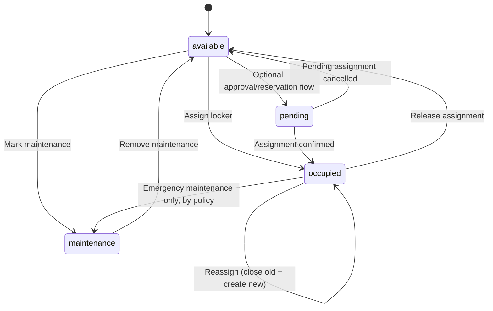

# SmartLibrary - Locker Management API Documentation

**Version:** 1.0  
**Module:** Common Locker Management - Owner & Coordinator  
**Audience:** Backend developers, Flutter developers, QA  
**Source UI:** `lib/features/common/lockers/`, `lib/features/owner/lockers_screen/`, `lib/features/coordinator/add_lockers/`, `lib/features/coordinator/assign_locker/`  
**Status:** Proposed API contract derived from the supplied Flutter source and checked against the existing API reference and Postman collection.

> **Implementation note:** The supplied locker providers currently use demo/static data. `AssignLockerProvider.confirmAssignment()` contains an API TODO, and the common locker provider initializes 12 sample lockers locally. The existing API reference/Postman collection already lists four locker routes. This document defines their complete contracts and the UI integration required; it does not claim the backend is implemented.

---

## 1. Purpose and screen coverage

Locker Management is a shared feature for **Owner and Coordinator**. The main Locker screen is the same for both roles; only the accent color and authorization scope differ. The supplied source contains these screens and UI surfaces:

| # | Screen / UI surface | Role | API responsibility |
|---|---|---|---|
| 1 | Lockers - overview | Owner & Coordinator | Load locker inventory, summary counts, status, location and assignment data |
| 2 | Search lockers | Owner & Coordinator | Search by locker number or assigned student |
| 3 | Locker status filters | Owner & Coordinator | Filter All, Assigned, Available, Pending, Half Day and Maintenance |
| 4 | Locker grid | Owner & Coordinator | Render locker tiles with current status |
| 5 | Locker Details bottom sheet | Owner & Coordinator | Show locker location/status and assigned-student details |
| 6 | Add Locker | Owner & Coordinator through shared `AppRoutes.addLocker` | Create a locker with number, block, floor, fee and initial status |
| 7 | Assign Locker | Coordinator route in current navigation | Select student, set assignment dates, review fee/payment summary and confirm assignment |
| 8 | Reassign / release / maintenance actions | Buttons appear in Locker Details | Use the existing assignment/release operation or the status operation described below |

The older `OwnerLockersScreen` file is also present. It contains a separate static layout with summary cards and a locker grid, but the current shared `LockersScreen` is the more complete implementation: it includes search, all six status filters, Add Locker navigation and the details bottom sheet. The API response should support both presentations without creating separate Owner and Coordinator locker datasets.

### 1.1 UI values and behavior found in source

The common `LockersProvider` currently defines:

- Statuses: `available`, `occupied`, `pending`, `halfDay`, `maintenance`.
- Filters: `all`, `assigned`, `available`, `pending`, `halfDay`, `maintenance`.
- Summary counts: Total Lockers, Assigned, Available and Maintenance.
- Search matches locker number or assigned student name.
- The sample provider creates 12 local lockers and derives a display number such as `L-101`.
- Assigned lockers show student details, roll number, class/department, assignment date and locker condition in the detail sheet. Several of these values are currently hardcoded placeholders.
- The Add Locker form contains locker name/number, block, floor, fee and initial status (`available` or `maintenance`).
- The Assign Locker form contains selected locker, selected student, start date, end date, total amount due, amount paid now and remaining balance.
- The current Add Locker provider defaults the sample fee to INR200. The assignment provider contains sample values (locker `B-18`, sample student, 12 Oct-12 Nov 2026 and INR250). These are examples only, not business defaults.
- `confirmAssignment()` is currently a placeholder.
- Locker detail actions such as Reassign, Delete student, Mark for Maintenance and Remove Maintenance have empty callbacks. They require wiring to the API contract below.

Do not hardcode these sample values in the backend.

---

## 2. Existing endpoints and duplicate policy

The uploaded `api_reference.md` and `smart-library-postman.json` already contain the following LOCKER routes:

| Method | Existing endpoint | Use in this module |
|---|---|---|
| GET | `/api/lockers` | List lockers, support search/filter/pagination and return summary |
| POST | `/api/lockers` | Create a locker |
| POST | `/api/lockers/:id/assign` | Assign or reassign a locker to a student |
| POST | `/api/lockers/:id/release` | Release the current locker assignment |

These are **existing endpoint names**. This document fills in the missing request/response contracts; it does not create duplicate equivalents under `/owner/lockers`, `/coordinator/lockers`, `/students/lockers` or another versioned prefix.

### 2.1 Existing supporting endpoints to reuse

| Existing endpoint | Why it is reused |
|---|---|
| `GET /api/students` | Student search/selection for assignment; use its existing search and student identity fields |
| `GET /api/payments/ledger/:studentId` | Show the student's existing payment ledger when payment details are needed |
| `POST /api/payments/record` | Record the amount paid during locker assignment; locker module must not create a second payment system |
| `POST /api/deposits` | Use only if the configured locker fee is explicitly a refundable security deposit; do not treat ordinary locker fees as deposits |
| `POST /api/deposits/:id/refund` | Refund a recorded refundable deposit through the existing deposit workflow |
| `GET /api/floors` | Populate/validate floor selection |
| `GET /api/reading-rooms` | Populate/validate block/room/hub context if blocks are modeled as reading-room locations |
| `GET /api/coordinators` | Existing coordinator identity/assignment records; not a locker-specific coordinator list |

The API reference uses `Authorization: Bearer ...` and `x-tenant-id`. The Postman locker requests use both headers. Keep this convention for this module.

### 2.2 Explicitly do not add duplicate endpoints

Do **not** create:

- `/api/owner/lockers` or `/api/coordinator/lockers` - both roles use `/api/lockers`.
- `/api/lockers/list`, `/api/lockers/search` or one endpoint per filter - use query parameters on `GET /api/lockers`.
- `/api/lockers/:id/allocate` - use the existing `/assign` route.
- `/api/lockers/:id/unassign`, `/remove-student` or `/vacate` - use the existing `/release` route.
- `/api/locker-payments` or `/api/lockers/:id/payment` - use `/api/payments/record` and the existing payment ledger.
- New student, floor, block/room, attendance or coordinator CRUD routes for this feature.

### 2.3 One additional status endpoint

The existing locker collection does not list a route for changing a locker between `available` and `maintenance`. The UI exposes **Mark for Maintenance** and **Remove Maintenance**, and Add Locker supports an initial maintenance status.

If no generic locker update/status route exists in the backend, add only:

`PATCH /api/lockers/:id/status`

This is a narrowly scoped extension to the existing Locker resource, not a second locker-management API. If a generic `PATCH /api/lockers/:id` already exists in the backend but is missing from the supplied reference, extend it to update status instead of adding this route.

---

## 3. Authentication, tenant scope and role permissions

### 3.1 Common headers

```http
Authorization: Bearer <ACCESS_TOKEN>
x-tenant-id: <TENANT_OR_HUB_ID>
Content-Type: application/json
Accept: application/json
```

- Resolve the user and role from the access token.
- Verify that `x-tenant-id` belongs to the authenticated Owner or is assigned to the Coordinator.
- Never trust `ownerId`, `coordinatorId` or `tenantId` supplied in a request body.
- Every locker query and mutation must be scoped to the authenticated tenant/hub.
- Coordinator requests must additionally be restricted to the coordinator's assigned hub and, if the product configures locker areas by block/floor, only the permitted block/floor scope.
- The Owner can manage all lockers within their authorized hub.
- The Coordinator can perform only the locker actions granted by their existing role/permission configuration. Do not assume every Coordinator has permission to create lockers, set fees or release assignments; enforce permissions server-side.
- The shared Flutter screen must not decide authorization based only on the accent color or `UserRole`.
- All timestamps are ISO 8601. Interpret assignment date-only values in the hub's configured timezone.
- Currency must use the hub's configured currency. The current UI shows INR.

### 3.2 Suggested permission matrix

| Action | Owner | Coordinator |
|---|---:|---:|
| View locker inventory | Yes | Yes, assigned scope |
| Search/filter lockers | Yes | Yes, assigned scope |
| View locker details | Yes | Yes, assigned scope |
| Add locker | Yes | Only with existing locker-management permission |
| Assign/reassign locker | Yes | Only with existing locker-assignment permission |
| Release locker | Yes | Only with existing locker-release/assignment permission |
| Mark/remove maintenance | Yes | Only with maintenance permission |
| Record payment | Through existing payment permission/workflow | Through existing fee-collection permission |

Use the actual permission identifiers configured by the platform. The matrix describes business authorization, not new permission names.

---

## 4. Common response envelope

The existing API reference and Postman collection do not provide locker response examples. Use the platform's established response envelope. The supplied Authentication specification uses `success`, `statusCode`, `message`, `data` and `timestamp`.

### 4.1 Success

```json
{
  "success": true,
  "statusCode": 200,
  "message": "Lockers retrieved successfully.",
  "data": {},
  "timestamp": "2026-11-24T10:30:00Z"
}
```

### 4.2 Error

```json
{
  "success": false,
  "statusCode": 422,
  "error": "LOCKER_VALIDATION_FAILED",
  "message": "The locker details are invalid.",
  "errors": [
    {
      "field": "lockerNumber",
      "message": "Locker number already exists in this hub."
    }
  ],
  "timestamp": "2026-11-24T10:30:00Z"
}
```

Keep error shape consistent with the API gateway's actual standard if it differs; do not introduce a locker-only envelope.

---

## 5. Locker data model

Recommended canonical locker object:

| Field | Type | Required | Description |
|---|---|---:|---|
| `id` | string | Yes | Stable locker ID |
| `lockerNumber` | string | Yes | Unique display number within tenant/hub |
| `displayName` | string/null | No | Optional friendly name |
| `blockId` | string/null | Depends on layout | Existing block/location reference, if modeled |
| `blockName` | string/null | No | Display label, e.g. Block A |
| `floorId` | string/null | Depends on layout | Existing floor reference |
| `floorName` | string/null | No | Display label, e.g. Ground Floor |
| `locationLabel` | string | Yes | Combined location label for UI |
| `feeAmount` | number | Yes | Configured locker fee/rate |
| `currency` | string | Yes | ISO currency code |
| `billingPeriod` | string | Yes | `daily`, `weekly`, `monthly`, `term`, or configured value |
| `status` | string | Yes | `available`, `occupied`, `pending`, `half_day`, `maintenance` |
| `condition` | string/null | No | `excellent`, `good`, `needs_repair`, `damaged`, etc. |
| `currentAssignment` | object/null | No | Current active/pending student assignment summary |
| `createdAt` | string | Yes | Creation timestamp |
| `updatedAt` | string | Yes | Last update timestamp |

### 5.1 Status mapping

Flutter enum names use camelCase for two values. API values should use stable snake_case:

| Flutter enum | API value | Meaning |
|---|---|---|
| `available` | `available` | Can be assigned |
| `occupied` | `occupied` | Currently assigned |
| `pending` | `pending` | Assignment or activation is awaiting completion/approval |
| `halfDay` | `half_day` | Assigned under a half-day locker policy, if supported by the business |
| `maintenance` | `maintenance` | Not assignable while maintenance is active |

**Important status decision:** `half_day` describes an assignment type/duration in the UI, not necessarily a physical availability state. The backend should retain assignment duration as a field (`usageType: full_day|half_day`) and derive the tile status consistently. Do not make a locker appear simultaneously `available` and `half_day`. Confirm whether the product wants half-day as a standalone locker status or as an assignment attribute before production.

`assigned` is a filter label in Flutter and maps to API status `occupied`; it is not a separate persisted status.

### 5.2 Assignment object

```json
{
  "id": "lka_1001",
  "student": {
    "id": "stu_2026_089",
    "studentCode": "STU-2026-089",
    "fullName": "Aditya Sharma",
    "rollNumber": "12",
    "classOrDepartment": "Class 9-B",
    "phone": "+919876543210",
    "profilePhotoUrl": null
  },
  "startDate": "2026-11-01",
  "endDate": "2026-11-30",
  "usageType": "full_day",
  "status": "active",
  "assignedAt": "2026-11-01T08:30:00Z",
  "lockerConditionAtAssignment": "excellent"
}
```

Only return fields the caller is authorized to see. Avoid returning identity documents or unrelated student personal data.

---

## 6. GET `/api/lockers` - list and overview

<badge color="success">Existing endpoint - extend its response contract</badge>

### Purpose

Load the shared Locker screen in one request, including:

- Locker grid data.
- Total, Assigned, Available and Maintenance summary cards.
- Search results.
- Status-filtered results.
- Current assigned student summary for locker detail sheets.
- Pagination metadata.

### Request

```http
GET /api/lockers
```

### Query parameters

| Parameter | Type | Required | Description |
|---|---|---:|---|
| `search` | string | No | Search locker number or assigned student's name/code |
| `status` | string | No | `available`, `occupied`, `pending`, `half_day`, `maintenance` |
| `blockId` | string | No | Filter by existing block/location ID |
| `floorId` | string | No | Filter by existing floor ID |
| `page` | integer | No | Default `1` |
| `limit` | integer | No | Default `50`, maximum recommended `200` |
| `sortBy` | string | No | `lockerNumber`, `createdAt`, `status` |
| `sortOrder` | string | No | `asc` or `desc`, default `asc` |
| `includeSummary` | boolean | No | Default `true` |
| `includeAssignment` | boolean | No | Default `true` |

Examples:

```http
GET /api/lockers?includeSummary=true&includeAssignment=true
GET /api/lockers?search=L-104
GET /api/lockers?search=Aditya
GET /api/lockers?status=available
GET /api/lockers?status=maintenance&floorId=floor_01
GET /api/lockers?blockId=block_a&page=1&limit=100
```

For the six Flutter filter chips:

- All -> omit `status`.
- Assigned -> `status=occupied`.
- Available -> `status=available`.
- Pending -> `status=pending`.
- Half Day -> `status=half_day`.
- Maintenance -> `status=maintenance`.

### Response

```json
{
  "success": true,
  "statusCode": 200,
  "message": "Lockers retrieved successfully.",
  "data": {
    "summary": {
      "total": 120,
      "assigned": 86,
      "available": 28,
      "pending": 0,
      "halfDay": 0,
      "maintenance": 6
    },
    "filters": {
      "search": "",
      "status": null,
      "blockId": null,
      "floorId": null
    },
    "items": [
      {
        "id": "lck_1001",
        "lockerNumber": "L-101",
        "displayName": "Locker L-101",
        "blockId": "block_a",
        "blockName": "Block A",
        "floorId": "floor_ground",
        "floorName": "Ground Floor",
        "locationLabel": "Block A - Ground Floor",
        "feeAmount": 200.00,
        "currency": "INR",
        "billingPeriod": "monthly",
        "status": "occupied",
        "condition": "excellent",
        "currentAssignment": {
          "id": "lka_1001",
          "student": {
            "id": "stu_2026_089",
            "studentCode": "STU-2026-089",
            "fullName": "Aditya Sharma",
            "rollNumber": "12",
            "classOrDepartment": "Class 9-B",
            "phone": "+919876543210"
          },
          "startDate": "2026-11-01",
          "endDate": "2026-11-30",
          "usageType": "full_day",
          "status": "active",
          "assignedAt": "2026-11-01T08:30:00Z"
        },
        "createdAt": "2026-10-10T10:00:00Z",
        "updatedAt": "2026-11-01T08:30:00Z"
      },
      {
        "id": "lck_1002",
        "lockerNumber": "L-102",
        "displayName": "Locker L-102",
        "blockId": "block_a",
        "blockName": "Block A",
        "floorId": "floor_ground",
        "floorName": "Ground Floor",
        "locationLabel": "Block A - Ground Floor",
        "feeAmount": 200.00,
        "currency": "INR",
        "billingPeriod": "monthly",
        "status": "available",
        "condition": "good",
        "currentAssignment": null,
        "createdAt": "2026-10-10T10:00:00Z",
        "updatedAt": "2026-11-20T10:00:00Z"
      }
    ],
    "pagination": {
      "page": 1,
      "limit": 50,
      "totalItems": 120,
      "totalPages": 3,
      "hasNext": true,
      "hasPrevious": false
    }
  },
  "timestamp": "2026-11-24T10:30:00Z"
}
```

### Rules

1. Summary counts must represent the full authorized inventory after applying tenant scope, not merely the current page. If a status filter is selected, keep summary counts for all statuses unless the product explicitly requests filtered counts.
2. `total` should equal the sum of mutually exclusive persisted statuses. Do not count one locker in both `occupied` and `half_day`.
3. `assigned` summary maps to `occupied` plus any separately defined active assignment status only if that is the agreed product definition. Document the formula and keep it stable.
4. Search must be tenant-scoped and should match normalized locker number, student name and student code.
5. The API should return the assignment summary in the same list response so the detail sheet does not need one request per tile.
6. Do not fetch every student's profile separately from Flutter. Join only the authorized display fields server-side.
7. If the inventory is small, the API may return all lockers in one page. Pagination must still be supported for larger hubs.
8. Return empty `items` and zero summary counts for a hub with no lockers; do not return a 404.

---

## 7. POST `/api/lockers` - add locker

<badge color="success">Existing endpoint - define request/response</badge>

### UI fields

The Add Locker screen contains:

- Locker Name / Number - required.
- Select Block - required.
- Floor Location - required.
- Set Fees - required numeric amount.
- Initial Status - `available` or `maintenance`.
- A preview card displaying the locker number.

### Request

```http
POST /api/lockers
```

```json
{
  "lockerNumber": "L-104",
  "displayName": "Locker L-104",
  "blockId": "block_a",
  "floorId": "floor_ground",
  "feeAmount": 200.00,
  "currency": "INR",
  "billingPeriod": "monthly",
  "initialStatus": "available",
  "condition": "good"
}
```

`blockId` and `floorId` should reference configured location records. If the existing product models blocks differently, use its canonical location identifier; do not create a second Block CRUD module solely for lockers.

### Field validation

| Field | Type | Required | Validation |
|---|---|---:|---|
| `lockerNumber` | string | Yes | Trimmed, 1-40 characters; unique within tenant |
| `displayName` | string | No | Up to 80 characters |
| `blockId` | string | As configured | Must belong to tenant |
| `floorId` | string | As configured | Must belong to tenant and selected block |
| `feeAmount` | decimal | Yes | Must be `>= 0`; precision follows currency |
| `currency` | string | Yes | Must match tenant currency unless multi-currency is supported |
| `billingPeriod` | string | Yes | Must be an allowed configured billing period |
| `initialStatus` | enum | Yes | Only `available` or `maintenance` from this form |
| `condition` | enum/null | No | Valid condition value |

### Response

```json
{
  "success": true,
  "statusCode": 201,
  "message": "Locker created successfully.",
  "data": {
    "locker": {
      "id": "lck_1104",
      "lockerNumber": "L-104",
      "displayName": "Locker L-104",
      "blockId": "block_a",
      "blockName": "Block A",
      "floorId": "floor_ground",
      "floorName": "Ground Floor",
      "locationLabel": "Block A - Ground Floor",
      "feeAmount": 200.00,
      "currency": "INR",
      "billingPeriod": "monthly",
      "status": "available",
      "condition": "good",
      "currentAssignment": null,
      "createdAt": "2026-11-24T10:30:00Z",
      "updatedAt": "2026-11-24T10:30:00Z"
    }
  },
  "timestamp": "2026-11-24T10:30:00Z"
}
```

### Rules

- Enforce uniqueness for `lockerNumber` within the tenant, using normalized comparison.
- A newly created locker cannot be `occupied`, `pending` or `half_day` without a valid assignment.
- `maintenance` lockers cannot be assigned.
- Do not create a payment transaction when the locker is created. The fee is configuration, not money received.
- The screen's current form uses hardcoded Block A/B/C and floor options. Replace these with existing configured block/floor data; reuse `GET /api/floors` and the appropriate existing location/reading-room data source.
- No separate locker update/delete endpoint is introduced here because the supplied UI only exposes Add Locker. If edit/delete is later added, extend the canonical Locker resource after checking the backend's existing generic update/delete routes.

---

## 8. POST `/api/lockers/:id/assign` - assign or reassign locker

<badge color="success">Existing endpoint - define request/response</badge>

### UI flow

The Assign Locker screen shows:

1. Selected locker and its location.
2. Selected student and student identity details.
3. Start date and end date.
4. Total Amount Due.
5. Amount Paid Now.
6. Remaining Balance.
7. Confirm & Assign Locker action.

The shared Locker Details bottom sheet also exposes **Assign Locker** for an available locker and **Reassign Locker** for an occupied locker. Reassignment must not silently overwrite an active assignment; it must release/close the old assignment and create the new assignment with an audit trail.

### Request

```http
POST /api/lockers/lck_1002/assign
```

```json
{
  "studentId": "stu_2026_089",
  "startDate": "2026-11-24",
  "endDate": "2026-12-23",
  "usageType": "full_day",
  "feeAmount": 200.00,
  "currency": "INR",
  "billingPeriod": "monthly",
  "reassign": false,
  "previousAssignmentId": null,
  "lockerConditionAtAssignment": "excellent",
  "notes": null
}
```

For a reassign action, set `reassign: true` and provide the currently active `previousAssignmentId`. Backend must verify that the old assignment belongs to this locker and tenant. If reassignment should release the previous student, capture the release reason and effective date as part of the same operation.

### Validation

- Locker exists in the authenticated tenant.
- Student exists in the same tenant and is eligible for locker assignment.
- Locker status is `available`, unless a valid explicit reassign workflow is requested.
- Locker is not under maintenance.
- `startDate` is a valid hub-local date.
- `endDate` is on or after `startDate`.
- The requested date interval must not conflict with another active assignment. If the business supports sequential or time-bounded reservations, enforce overlap rules.
- `usageType` is `full_day` or `half_day` if those modes are supported.
- The fee must be derived from the configured locker fee/billing rules. A client-supplied amount may be sent for confirmation but must not override server pricing without an authorized discount/override rule.
- Use an idempotency key for retries so a double tap does not create duplicate assignments.

### Response

```json
{
  "success": true,
  "statusCode": 201,
  "message": "Locker assigned successfully.",
  "data": {
    "assignment": {
      "id": "lka_1102",
      "lockerId": "lck_1002",
      "lockerNumber": "L-102",
      "student": {
        "id": "stu_2026_089",
        "studentCode": "STU-2026-089",
        "fullName": "Aditya Sharma",
        "rollNumber": "12",
        "classOrDepartment": "Class 9-B",
        "phone": "+919876543210"
      },
      "startDate": "2026-11-24",
      "endDate": "2026-12-23",
      "usageType": "full_day",
      "feeAmount": 200.00,
      "currency": "INR",
      "billingPeriod": "monthly",
      "status": "active",
      "assignedAt": "2026-11-24T10:30:00Z",
      "lockerConditionAtAssignment": "excellent",
      "previousAssignmentId": null
    },
    "locker": {
      "id": "lck_1002",
      "lockerNumber": "L-102",
      "status": "occupied"
    },
    "paymentSummary": {
      "amountDue": 200.00,
      "amountPaid": 0.00,
      "remainingBalance": 200.00,
      "currency": "INR",
      "paymentStatus": "unpaid"
    }
  },
  "timestamp": "2026-11-24T10:30:00Z"
}
```

### Reassignment behavior

- A reassign action must be auditable.
- Close the old assignment with `releasedAt`, `releaseReason` and actor identity before activating the new assignment, within one database transaction.
- Do not delete the previous assignment.
- If the old student has unpaid fees, keep those dues in the canonical payment/fee records; do not transfer the old balance to the new student.
- Return the new assignment and the previous assignment's final status in the response if the UI needs to display confirmation.

---

## 9. Payment handling - reuse existing payment APIs

The Assign Locker screen displays a payment summary, but the locker module must not implement its own payment ledger.

### Recommended sequence

1. Call `POST /api/lockers/:id/assign` to create the assignment and obtain the server-calculated amount due.
2. If the user records an amount paid now, call the existing `POST /api/payments/record` with the locker assignment as the reference/source.
3. Refresh the student's existing payment ledger with `GET /api/payments/ledger/:studentId` when the UI needs transaction history.
4. Refresh `GET /api/lockers` to update the tile and summary.

The existing payment endpoint should be extended to accept a generic reference to a payable item if it does not already support this. Do not create a parallel locker payment route.

### Existing payment record integration example

The exact field names must follow the existing Payments API contract. The following illustrates the required linkage, not a new endpoint:

```http
POST /api/payments/record
```

```json
{
  "studentId": "stu_2026_089",
  "referenceType": "locker_assignment",
  "referenceId": "lka_1102",
  "amount": 200.00,
  "currency": "INR",
  "paymentMethod": "bank_transfer",
  "paymentDate": "2026-11-24",
  "notes": "Locker L-102 fee"
}
```

The API must return a canonical payment transaction ID and the updated balance. If the existing payment service does not support `referenceType=locker_assignment`, extend its existing contract rather than creating `/api/lockers/:id/payment`.

### Payment calculations

- `amountDue`: server-calculated fee for the assignment period.
- `amountPaid`: sum of successful/settled payments allocated to this locker assignment.
- `remainingBalance`: `max(amountDue - amountPaid, 0)`.
- `paymentStatus`: `unpaid`, `partially_paid`, `paid`, or `overpaid` according to the canonical payment rules.
- Failed, pending or cancelled payment attempts must not reduce the outstanding balance.
- Do not assume that amount paid now equals the total due. Partial payment is valid if the existing payment policy permits it.
- If the locker fee is a refundable deposit, use the existing Deposit APIs instead of treating it as ordinary locker revenue.

---

## 10. POST `/api/lockers/:id/release` - release locker

<badge color="success">Existing endpoint - define request/response</badge>

### Purpose

Release the current assignment when a student no longer uses the locker, or when an assignment ends. This is the canonical operation behind release/unassign. It may also be called by the Reassign workflow internally.

### Request

```http
POST /api/lockers/lck_1001/release
```

```json
{
  "assignmentId": "lka_1001",
  "effectiveDate": "2026-11-24",
  "reason": "student_membership_ended",
  "notes": "Locker returned in good condition",
  "conditionAtRelease": "good"
}
```

### Response

```json
{
  "success": true,
  "statusCode": 200,
  "message": "Locker released successfully.",
  "data": {
    "locker": {
      "id": "lck_1001",
      "lockerNumber": "L-101",
      "status": "available"
    },
    "assignment": {
      "id": "lka_1001",
      "status": "released",
      "releasedAt": "2026-11-24T10:30:00Z",
      "effectiveDate": "2026-11-24",
      "reason": "student_membership_ended",
      "conditionAtRelease": "good"
    },
    "paymentSummary": {
      "outstandingAmount": 0.00,
      "currency": "INR"
    }
  },
  "timestamp": "2026-11-24T10:30:00Z"
}
```

### Rules

- Require the active `assignmentId` to prevent releasing a newer assignment accidentally.
- A release must close the assignment record; do not delete it.
- Locker returns to `available` only if it is not under maintenance and has no overlapping future reservation.
- If condition at release indicates damage, the locker may be moved to `maintenance` according to policy. Do not automatically charge a damage fee unless a separately authorized charge workflow exists.
- Outstanding locker dues remain on the student's canonical ledger; releasing a locker must not erase them.
- A refundable deposit, if applicable, must be refunded through `POST /api/deposits/:id/refund` after the appropriate checks.
- Return `409` if there is no active assignment or the supplied assignment ID is stale.

---

## 11. PATCH `/api/lockers/:id/status` - maintenance status

<badge color="info">New only if no generic locker status/update route exists</badge>

### Purpose

Wire the Locker Details actions:

- Mark for Maintenance.
- Remove Maintenance.

Also supports creating a locker with `initialStatus=maintenance`; the initial state is set through `POST /api/lockers`, so no extra call is needed on creation.

### Mark for maintenance

```http
PATCH /api/lockers/lck_1002/status
```

```json
{
  "status": "maintenance",
  "reason": "lock_mechanism_repair",
  "notes": "Key mechanism needs inspection"
}
```

### Remove maintenance

```json
{
  "status": "available",
  "reason": "repair_completed",
  "notes": "Locker checked and cleared for use"
}
```

### Response

```json
{
  "success": true,
  "statusCode": 200,
  "message": "Locker status updated successfully.",
  "data": {
    "locker": {
      "id": "lck_1002",
      "lockerNumber": "L-102",
      "status": "maintenance",
      "condition": "needs_repair",
      "updatedAt": "2026-11-24T10:30:00Z"
    }
  },
  "timestamp": "2026-11-24T10:30:00Z"
}
```

### Rules

- Allowed status changes from this endpoint should be limited to maintenance transitions (`available`   `maintenance`) unless a broader status-transition matrix is explicitly defined.
- Do not permit changing an occupied locker to available through this endpoint. Release its assignment first.
- Do not permit a locker with an active assignment to enter maintenance unless the business explicitly supports emergency maintenance while assigned. If allowed, the assignment must be flagged and the student notified by the existing notification system.
- Record actor, old status, new status, reason, timestamp and tenant in the audit log.
- Removing maintenance should set the locker to `available` only after the locker is confirmed usable.

---

## 12. Locker Details bottom sheet

The detail sheet is not a separate screen endpoint. It opens from a locker tile and should use the item returned by `GET /api/lockers`.

### Data needed by the sheet

| UI element | Data source |
|---|---|
| Locker number | `locker.lockerNumber` |
| Location | `locker.locationLabel` |
| Status badge | `locker.status` |
| Assigned student name | `currentAssignment.student.fullName` |
| Class/department | `currentAssignment.student.classOrDepartment` |
| Roll number | `currentAssignment.student.rollNumber` |
| Date Assigned | `currentAssignment.assignedAt` or `startDate`, with label semantics agreed |
| Locker Condition | `currentAssignment.lockerConditionAtAssignment` or current `locker.condition` |
| Assign Locker | Existing `POST /api/lockers/:id/assign` |
| Reassign Locker | Existing assign operation with explicit reassign workflow |
| Mark for Maintenance | `PATCH /api/lockers/:id/status` or existing generic locker update route |
| Remove Maintenance | Same status route |
| Release assignment | Existing `POST /api/lockers/:id/release` |

The current sheet includes Call and Chat icons with empty callbacks. If wired, use existing phone/contact and notification/deep-link behavior. Do not add locker-specific communication endpoints.

The current sheet includes a "Delete student" label, but this must **not** delete a student record. If the intended action is to remove the student from the locker, wire it to the existing release endpoint and rename the UI action to **Release Locker** or **Remove Assignment** to avoid destructive ambiguity.

### Optional detail fetch

A separate `GET /api/lockers/:id` is **not required** for the current screen if `GET /api/lockers` includes `currentAssignment` and the displayed details. If the list payload is intentionally kept lightweight, a generic detail route may be added only after checking whether the backend already has one; do not make one request per locker tile.

---

## 13. Assignment lifecycle and state transitions

Recommended lifecycle:



Rules:

- The backend is the source of truth for locker status.
- `pending` should be used only if there is a real approval/reservation/payment-pending workflow. The current UI displays it but does not define how it is created or approved.
- `half_day` should preferably be an assignment usage type rather than a separate inventory status. If the product keeps it as a visible status, define whether it blocks assignment for the full day or only the relevant time window.
- Prevent concurrent assignment with a database transaction/row lock or equivalent.
- Preserve assignment history for all assign, reassign and release actions.
- A locker should never have two overlapping active assignments unless the product explicitly supports shared/time-slot use.

---

## 14. Search, filters and summary behavior

### Search

- Search by locker number, assigned student's name or student code.
- Case-insensitive and whitespace-trimmed.
- Debounce requests in Flutter (recommended 300-400 ms).
- Reset page to `1` when search changes.
- Search must be scoped to the caller's authorized hub and coordinator area.

### Filters

| Flutter filter | API query | Summary behavior |
|---|---|---|
| All | No `status` | Show all lockers |
| Assigned | `status=occupied` | Show occupied lockers |
| Available | `status=available` | Show available lockers |
| Pending | `status=pending` | Show pending lockers |
| Half Day | `status=half_day` | Show half-day lockers/assignments according to agreed model |
| Maintenance | `status=maintenance` | Show maintenance lockers |

The main screen summary cards currently show Total Lockers, Assigned, Available and Maintenance. Pending and Half Day counts exist in the provider but are not summary cards in the current common screen. Return them in `summary` so the filter counts can be displayed later without another endpoint.

---

## 15. Error codes

Use the platform's standard error envelope and HTTP codes.

| HTTP | Error code | Meaning / client behavior |
|---:|---|---|
| 400 | `INVALID_LOCKER_STATUS` | Unsupported status value |
| 400 | `INVALID_ASSIGNMENT_DATES` | End date precedes start date or invalid date |
| 401 | `TOKEN_EXPIRED` | Use existing authentication refresh flow |
| 403 | `ROLE_NOT_AUTHORIZED` | Role or permission does not allow this action |
| 403 | `LOCKER_SCOPE_FORBIDDEN` | Coordinator is outside assigned hub/block/floor scope |
| 404 | `LOCKER_NOT_FOUND` | Locker does not exist in authorized tenant |
| 404 | `STUDENT_NOT_FOUND` | Student does not exist in authorized tenant |
| 404 | `FLOOR_NOT_FOUND` | Floor/location reference is invalid |
| 409 | `LOCKER_NUMBER_EXISTS` | Locker number already exists in tenant |
| 409 | `LOCKER_NOT_AVAILABLE` | Locker is occupied, pending, reserved or in maintenance |
| 409 | `LOCKER_ASSIGNMENT_CONFLICT` | Another active assignment overlaps requested dates |
| 409 | `LOCKER_ASSIGNMENT_NOT_ACTIVE` | Release requested for a stale/non-active assignment |
| 409 | `LOCKER_HAS_ACTIVE_ASSIGNMENT` | Maintenance or status transition conflicts with active assignment |
| 422 | `LOCKER_VALIDATION_FAILED` | One or more fields failed validation |
| 422 | `INVALID_LOCKER_FEE` | Fee is invalid or violates configured pricing |
| 429 | `RATE_LIMITED` | Respect `Retry-After` |
| 500 | `INTERNAL_ERROR` | Show retry state and retain form input |

---

## 16. Audit, concurrency and security

- Record `createdBy`, `updatedBy`, `assignedBy`, `releasedBy` and `statusChangedBy` from the authenticated session.
- Audit locker creation, assignment, reassignment, release and maintenance transitions.
- Keep immutable assignment history; do not overwrite old student assignment details.
- Use idempotency keys for create/assign/release operations where client retries are possible.
- Enforce tenant isolation at the database query layer, not only in Flutter.
- Validate all referenced student, floor and block IDs against the current tenant.
- Do not expose student identity documents, emergency contacts or unrelated personal information in locker list responses.
- Protect against concurrent assignment requests. Two coordinators must not be able to assign the same available locker simultaneously.
- Do not let a Coordinator alter another hub's locker fee or inventory.
- Log export/download is not part of the current Locker UI; do not add export endpoints.

---

## 17. Flutter integration mapping

Suggested API service: `LockerApi`

```dart
Future<LockerListResponse> getLockers({
  String? search,
  String? status,
  String? blockId,
  String? floorId,
  int page = 1,
  int limit = 50,
});

Future<LockerModel> addLocker({
  required String lockerNumber,
  required String blockId,
  required String floorId,
  required double feeAmount,
  required String billingPeriod,
  required String initialStatus,
});

Future<LockerAssignmentResponse> assignLocker({
  required String lockerId,
  required String studentId,
  required DateTime startDate,
  required DateTime endDate,
  required String usageType,
});

Future<LockerReleaseResponse> releaseLocker({
  required String lockerId,
  required String assignmentId,
  required DateTime effectiveDate,
  required String reason,
});

Future<LockerModel> updateLockerStatus({
  required String lockerId,
  required String status,
  required String reason,
});
```

The method signatures are illustrative client contracts; adapt names to the existing repository/service conventions.

### Provider mapping

| Flutter source | Required integration |
|---|---|
| `LockersProvider._loadLockers()` | Replace demo initialization with `GET /api/lockers` |
| `LockersProvider._lockers` | Populate from `data.items` |
| `totalLockers` | `data.summary.total` |
| `assignedCount` | `data.summary.assigned` |
| `availableCount` | `data.summary.available` |
| `pendingCount` | `data.summary.pending` |
| `halfDayCount` | `data.summary.halfDay` |
| `maintenanceCount` | `data.summary.maintenance` |
| `searchController` | Call `GET /api/lockers?search=...` with debounce |
| `selectFilter()` | Call `GET /api/lockers?status=...` |
| Locker tile tap | Use the selected item and its `currentAssignment` to open bottom sheet |
| Add Locker form | Populate block/floor choices from existing location endpoints; submit `POST /api/lockers` |
| `AssignLockerProvider` | Load selected locker and student from route arguments/API data; submit existing assign endpoint |
| `confirmAssignment()` | Call assign endpoint, then existing payment endpoint if payment is recorded |
| Reassign Locker action | Call existing assign endpoint with explicit reassign context |
| Release action | Call existing release endpoint |
| Mark/Remove Maintenance | Call the canonical status/update route |
| Detail student card | Bind actual student/assignment fields; remove hardcoded sample class, roll and date values |

### Screen refresh rules

Refresh `GET /api/lockers`:

- When the Locker screen opens.
- After adding a locker.
- After assigning or reassigning a locker.
- After releasing a locker.
- After marking or removing maintenance.
- When search or status filter changes.
- When the active hub changes.
- When returning to the screen after a relevant mutation.

Retain the selected search/filter state after a mutation where practical. Do not show stale locker counts or an old student assignment after a successful operation.

### Route and role notes

- Shared screen: `LockersScreen(role: UserRole)` for Owner and Coordinator.
- Existing Add Locker route: `AppRoutes.addLocker`.
- Existing Assign Locker route in the shared screen: `AppRoutes.coordinatorAssignLocker`.
- The current common screen passes the Coordinator Assign Locker route even when rendered for Owner. If Owner can assign lockers, confirm that this route is intentionally shared or route both roles to the same assignment screen. This is a Flutter navigation concern; it does not justify duplicate Owner/Coordinator API endpoints.
- The standalone `OwnerLockersScreen` is static and is not currently wired to `LockersProvider`. Prefer one shared data contract and one provider/repository rather than maintaining separate Owner and Coordinator locker datasets.

---

## 18. Endpoint summary

### Existing endpoints - use and document, do not duplicate

| Method | Endpoint | Status | Screen/action |
|---|---|---|---|
| GET | `/api/lockers` | Existing | Locker overview, search, filters, counts and detail data |
| POST | `/api/lockers` | Existing | Add Locker |
| POST | `/api/lockers/:id/assign` | Existing | Assign / Reassign Locker |
| POST | `/api/lockers/:id/release` | Existing | Release assignment |
| GET | `/api/students` | Existing | Student selection |
| GET | `/api/floors` | Existing | Floor selection |
| GET | `/api/reading-rooms` | Existing | Existing location/block context where applicable |
| POST | `/api/payments/record` | Existing | Record locker assignment payment |
| GET | `/api/payments/ledger/:studentId` | Existing | Existing student payment ledger |
| POST | `/api/deposits` | Existing | Refundable deposit only, if applicable |
| POST | `/api/deposits/:id/refund` | Existing | Refund eligible deposit |

### One conditional extension

| Method | Endpoint | Status | Purpose |
|---|---|---|---|
| PATCH | `/api/lockers/:id/status` | New only if no generic locker update/status route exists | Mark / remove maintenance |

No Owner-specific or Coordinator-specific locker endpoints are required. Both roles use the same Locker API with server-enforced role and scope permissions.

---

## 19. Decisions to confirm before backend implementation

The Flutter source leaves several business rules unresolved. Confirm these before finalizing production behavior:

1. **Block model:** Are Block A/B/C first-class entities, reading-room locations, or labels attached to floors? Reuse the canonical location model.
2. **Locker billing period:** Is the fee daily, monthly, per membership term, or a one-time fee? The current form shows only a numeric fee and does not expose the billing period.
3. **Half-day behavior:** Is half-day a real locker allocation mode, or only a visual status? Prefer `usageType=half_day` on an assignment.
4. **Pending behavior:** What creates a pending locker, and who approves or completes it? The current UI displays pending but has no pending action flow.
5. **Assignment payment:** Is payment required before assignment, optional, or allowed as a partial payment? The UI displays a paid-now amount and remaining balance.
6. **Reassignment:** Does reassigning immediately release the old student's locker, or should the user first complete a separate release?
7. **Locker condition:** Which condition values should be supported, and can damage automatically trigger maintenance?
8. **Coordinator permissions:** Can Coordinators add lockers and change fees, or only assign/release lockers in their assigned area?
9. **Owner route:** Should Owner use the same `AssignLockerScreen` route as Coordinator? The current shared Locker screen routes to `AppRoutes.coordinatorAssignLocker`.

These are product decisions, not reasons to create more endpoints.

---

## 20. Final implementation checklist

- [ ] Keep the four existing locker route paths unchanged.
- [ ] Implement list response with summary, filters, pagination and assignment summary.
- [ ] Connect the shared Owner/Coordinator Locker screen to `GET /api/lockers`.
- [ ] Replace hardcoded block/floor choices with existing location data.
- [ ] Connect Add Locker to `POST /api/lockers`.
- [ ] Connect Assign/Reassign to `POST /api/lockers/:id/assign`.
- [ ] Record money only through the existing Payments API.
- [ ] Connect release to `POST /api/lockers/:id/release`.
- [ ] Add/extend one maintenance status operation only if no generic locker update route exists.
- [ ] Enforce Owner and Coordinator authorization on the backend.
- [ ] Preserve assignment history and audit all mutations.
- [ ] Remove sample locker/student/payment values from the production provider.
- [ ] Test simultaneous assignment, duplicate locker number, expired assignment, partial payment, maintenance lockout and tenant isolation.

---

**End of document.**  
This specification describes the API contract required by the supplied Locker UI. Existing route names are preserved; proposed response fields and business rules must be reconciled with the backend implementation before release.
